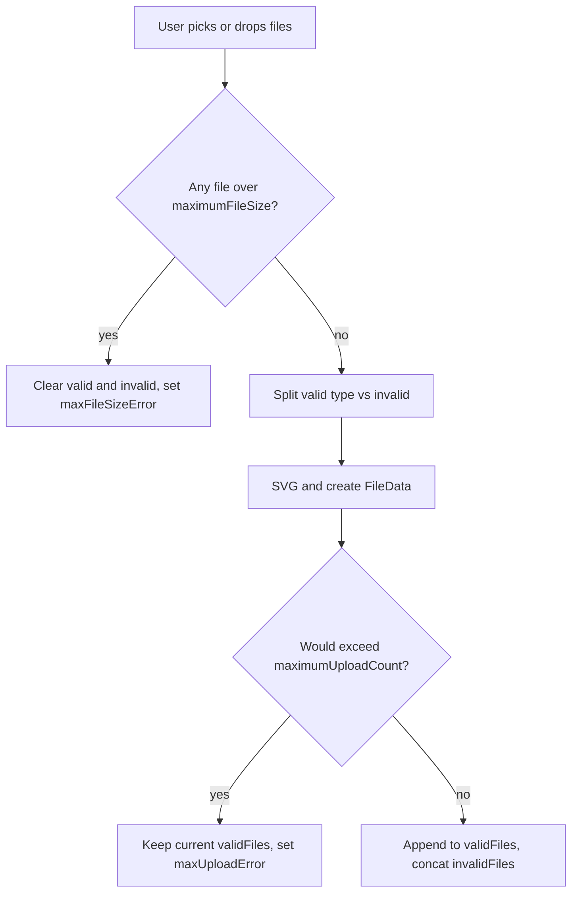

# @mainframework/dropzone

A React package that allows for the selection of files through drag and drop or the File Dialog API. Re-rendering is kept to a minimum, helping with application performance.

## Installation

```bash
npm i @mainframework/dropzone
# or
pnpm add @mainframework/dropzone
```

## Requirements

- **React** `>= 19` (peer dependency)
- ESM package: import from `@mainframework/dropzone`

## Breaking changes (2.0.0)

- **`maxFileSizeError`** also reflects file read/processing failures (for example SVG processing). Always show `maxFileSizeError.message` in your UI; do not assume the text is only about file size.
- **`setMaximumFileSizeExceeded(status, message?)`** — optional second argument sets a custom message when `status` is `true`.
- **`FileSelector`** is exported from `@mainframework/dropzone` for custom wiring (handlers and validation remain your responsibility when not using the hook’s bound component).
- New hook option **`allowMultiple`** (default `true`). New view props on `FileSelector`: **`disabled`**, **`dragActiveClassName`**, and **`multiple`** (when using the standalone component).
- **`FileData.type`** is the canonical extension string from your accept map (for example `".png"`), not necessarily the file’s MIME type.
- Default accept map includes **`image/jpg`** → `.jpg` in addition to `image/jpeg` → `.jpeg`.

See also [Selection and validation behavior](#selection-and-validation-behavior) and [Standalone `FileSelector`](#standalone-fileselector).

## Running Tests

```bash
pnpm test
# or
npm run test
pnpm test:coverage
# or
npm run test:coverage
```

## Hook Configuration

The `useFileSelector` hook accepts optional configuration:

```ts
import { useFileSelector, defaultTypeExtensions } from "@mainframework/dropzone";

const { ... } = useFileSelector({
  maximumUploadCount: 5,      // Default: 30
  maximumFileSize: 5e6,       // Default: 5 MB
  acceptedTypes: defaultTypeExtensions,  // MIME type -> extension map; omit to use the built-in default
  allowMultiple: true,        // Default: true
});
```

Omit `acceptedTypes` to use the built-in default map (same values as `defaultTypeExtensions`).

`acceptedTypes` is read when the hook mounts; changing the object after mount without remounting the hook does not refresh accept validation.

Single-file selection: `useFileSelector({ allowMultiple: false })`.

## Minimal Usage

```tsx
import { useFileSelector } from "@mainframework/dropzone";

export function Uploader() {
  const { FileSelector, validFiles, invalidFiles, clearCache } = useFileSelector();

  return (
    <>
      <FileSelector messageParagraph="Drop files here or click to select" />

      {invalidFiles.length > 0 && <p role="alert">Some files were rejected.</p>}

      <button type="button" onClick={clearCache} disabled={validFiles.length === 0}>
        Clear
      </button>
    </>
  );
}
```

## Hook Exports

The hook returns the following:

### Properties

| Export         | Type         | Description                                                                                                   |
| -------------- | ------------ | ------------------------------------------------------------------------------------------------------------- |
| `validFiles`   | `FileData[]` | Files that passed validation (accepted type, size, and count). Each item has `id`, `file`, `url`, and `type` (extension string from the accept map). |
| `invalidFiles` | `File[]`     | Files that failed validation or processing; accumulates until cleared. Includes wrong type and processing failures. |

### Methods

| Export                | Signature                                                | Description                                                                                    |
| --------------------- | -------------------------------------------------------- | ---------------------------------------------------------------------------------------------- |
| `clearCache`          | `() => void`                                             | Clears both `validFiles` and `invalidFiles`, and revokes blob URLs to free memory.             |
| `getValidFileStreams` | `() => (File \| Blob)[]`                                 | Returns the raw `File` or `Blob` instances from `validFiles`; returns an empty array when there are no valid files. |
| `onCancel`            | `() => void`                                             | Same as `clearCache`; use when the user cancels selection.                                     |
| `onIdChange`          | `(index: number, id: string, files: FileData[]) => void` | Renames a file by ID. Pass the index, new ID, and current `validFiles` array.                  |
| `onRemoveFile`        | `(index: number) => void`                                | Removes the file at the given index from `validFiles` and revokes its blob URL.                |
| `clearBlobs`          | `() => void`                                             | Revokes blob URLs for valid entries whose `file` is a `File`. Does not clear the arrays.       |
| `clearBlob`           | `(file: File) => void`                                   | Revokes the blob URL for a single `File` in the registry. Plain `Blob` entries may have no registered URL. |

### Error State

| Export                       | Type                                                                      | Description                                                                                                 |
| ---------------------------- | ------------------------------------------------------------------------- | ----------------------------------------------------------------------------------------------------------- |
| `maxUploadError`             | `{ status: boolean; message: string }`                                    | Reflects whether the max upload count was exceeded. Check `status` and show `message` in your UI.           |
| `maxFileSizeError`           | `{ status: boolean; message: string }`                                    | Max size exceeded or file processing failed. Default processing message when the hook sets the error without a custom `message`. |
| `setMaximumUploadsExceeded`  | `(status?: boolean, fileCount?: number, maximumUploads?: number) => void` | When `status` is `true`, pass `fileCount` and `maximumUploads` for the built-in message; call with `false` to clear. |
| `setMaximumFileSizeExceeded` | `(status?: boolean, message?: string) => void`                            | Sets the max file size / processing error. Optional `message` when `status` is `true`; call with `false` to clear. |

### Component

| Export         | Description                                                                                                                    |
| -------------- | ------------------------------------------------------------------------------------------------------------------------------ |
| `FileSelector` | From `useFileSelector()` (pre-wired) or `import { FileSelector } from "@mainframework/dropzone"` (you supply handlers). |

### FileSelector props (`FileSelectorViewProps`)

The `FileSelector` from the hook accepts **view-only** props (styling, copy, accessibility). Do not pass `onChange` or drag handlers; the hook supplies those. When rendering it, you can pass:

| Prop                        | Type     | Default                                                   | Description                                  |
| --------------------------- | -------- | --------------------------------------------------------- | -------------------------------------------- |
| `inputId`                   | `string` | auto-generated                                            | ID for the file input (for `aria-controls`). |
| `messageParagraph`          | `string` | "Drag 'n' drop some files here, or click to select files" | Text shown in the dropzone.                  |
| `inputClassName`            | `string` | `"hiddenInput"`                                           | CSS classes for the hidden input.            |
| `clickableAreaClassName`    | `string` | Tailwind dropzone styles                                  | CSS classes for the clickable area.          |
| `dropZoneWrapperClassName`  | `string` | Tailwind wrapper styles                                   | CSS classes for the outer wrapper.           |
| `messageParagraphClassName` | `string` | Tailwind text styles                                      | CSS classes for the message text.            |
| `ariaLabel`                 | `string` | "File upload drop zone"                                   | Accessible name for the drop zone.           |
| `ariaDescribedBy`           | `string` | —                                                         | ID of element that describes the drop zone.  |
| `ariaLabelButton`           | `string` | "Choose files to upload"                                  | Accessible label for the button.             |
| `dragActiveClassName`       | `string` | `border-gray-500`                                         | Extra classes on the button while dragging.  |
| `disabled`                  | `boolean` | `false`                                                  | Disables the dropzone button.                |

The drop zone group uses `aria-describedby` pointing at the message paragraph when `ariaDescribedBy` is omitted.

## Styling

- Default UI uses **bundled CSS** imported by `FileSelector`; you do not need Tailwind in your app for the default look.
- Utility classes are scoped under **`.file-selector-scope`**.
- Override appearance with `inputClassName`, `clickableAreaClassName`, `dropZoneWrapperClassName`, `messageParagraphClassName`, and `dragActiveClassName` (merged with `clsx` and `tailwind-merge`).
- The hidden file input uses the `.hiddenInput` class from the bundled stylesheet.

## Standalone `FileSelector`

- **Hook-bound** `FileSelector` (from `useFileSelector()`): pass only **`FileSelectorViewProps`**. The hook supplies handlers, `accept`, `multiple`, and `isDragActive`.
- **Standalone** `import { FileSelector } from "@mainframework/dropzone"`: you must pass **`FileSelectorHandlerProps`** (`onChange`, `onDragOver`, `onDrop`, `onDragEnter`, `onDragLeave`). File validation and upload logic are your responsibility.

Exported type **`FileSelectorProps`** combines view props, handler props, and `accept`, `isDragActive`, and `multiple`.

### Standalone-only props

| Prop           | Type      | Default                         | Description                                      |
| -------------- | --------- | ------------------------------- | ------------------------------------------------ |
| `accept`       | `string`  | built-in default accept string  | `accept` attribute for the hidden file input.    |
| `multiple`     | `boolean` | `true`                          | Allow selecting more than one file.              |
| `isDragActive` | `boolean` | `false`                         | Applies `dragActiveClassName` while dragging.    |

```tsx
import { FileSelector } from "@mainframework/dropzone";

// Prefer useFileSelector() for validation and state; standalone is for custom wiring.
export function CustomDropzone() {
  const onChange = () => {};
  const onDragOver = () => {};
  const onDrop = () => {};
  const onDragEnter = () => {};
  const onDragLeave = () => {};

  return (
    <FileSelector
      onChange={onChange}
      onDragOver={onDragOver}
      onDrop={onDrop}
      onDragEnter={onDragEnter}
      onDragLeave={onDragLeave}
      multiple={false}
    />
  );
}
```

## Default Accepted Types

The package validates files against a MIME type map. Import `defaultTypeExtensions` and pass it to `acceptedTypes`, spread it and override keys, or pass your own `Record<string, string>`:

```ts
import { defaultTypeExtensions } from "@mainframework/dropzone";

// Built-in default map:
const defaultMap: Record<string, string> = {
  "image/png": ".png",
  "image/jpeg": ".jpeg",
  "image/jpg": ".jpg",
  "image/svg+xml": ".svg",
  "application/pdf": ".pdf",
  "application/msword": ".doc",
  "application/vnd.openxmlformats-officedocument.wordprocessingml.document": ".docx",
};

// Or use the export directly:
// acceptedTypes: defaultTypeExtensions
```

## Selection and validation behavior

| Topic | Behavior |
| ----- | -------- |
| **Type validation** | A file is accepted if its MIME type is in `acceptedTypes` **or** its extension matches a value in the map. |
| **`invalidFiles`** | Accumulates across selections until `clearCache` or `onCancel`. Includes wrong-type files and files that failed processing. |
| **Max file size** | If any file in a batch exceeds `maximumFileSize`, all `validFiles` and `invalidFiles` are cleared, blob URLs are revoked, and `maxFileSizeError` is set (the message is not updated if the error is already active). |
| **Max upload count** | If adding a batch would exceed `maximumUploadCount`, existing `validFiles` are kept, new files are not added, and `maxUploadError` is set. |
| **SVG** | SVGs missing `xmlns` on `<svg>` may get `xmlns` injected. Read or processing failures set `maxFileSizeError` (default message: `One or more files could not be processed. Please try again.`). |
| **Re-select same file** | The file input value is cleared after each selection so the same file can be chosen again. |
| **`allowMultiple: false`** | Sets `multiple={false}` on the hook-wired file input. |



## Usage Example

```tsx
import { useFileSelector } from "@mainframework/dropzone";

export const App = () => {
  const {
    validFiles,
    invalidFiles,
    onIdChange,
    onCancel,
    onRemoveFile,
    FileSelector,
    maxUploadError,
    maxFileSizeError,
  } = useFileSelector({
    maximumUploadCount: 5,
    maximumFileSize: 5e6,
  });

  const onSelect = () => {
    if (Array.isArray(validFiles)) {
      // Use validFiles for upload or preview
    }
  };

  return (
    <>
      <FileSelector messageParagraph="Drop files here or click to select" />

      {maxUploadError.status && <p role="alert">{maxUploadError.message}</p>}
      {maxFileSizeError.status && <p role="alert">{maxFileSizeError.message}</p>}

      {validFiles.length > 0 && (
        <PreviewImages
          validFiles={validFiles}
          onChange={onIdChange}
          onSelect={onSelect}
          onCancel={onCancel}
          onRemoveFile={onRemoveFile}
        />
      )}
    </>
  );
};
```

## Cleanup / memory

> **Warning: memory management is the caller's responsibility.** The hook does **not** automatically revoke blob URLs on unmount. You **must** call `clearBlobs()` or `clearCache()` yourself — for example in a `useEffect` cleanup, on cancel, or after a successful upload — to prevent memory leaks.

```tsx
useEffect(() => {
  return () => {
    clearBlobs(); // revoke all blob URLs when the component unmounts
  };
}, [clearBlobs]);
```

- Use `clearCache()` / `onCancel()` to clear files **and** revoke blob URLs, and to clear `maxUploadError` and `maxFileSizeError`.
- Use `onRemoveFile(index)` to remove one file and revoke its blob URL.
- Use `clearBlobs()` to revoke blob URLs without clearing the file arrays.
- Mutating the `validFiles` array directly (for example `validFiles.length = 0`) is not a supported way to clear files/blobs; use `clearCache()` instead so blob URLs are properly revoked.

## Exported types

If you need types externally, the package exports:

- `FileData`
- `ErrorMessage`
- `IFileUploaderProps`
- `FileSelectorViewProps`
- `FileSelectorHandlerProps`
- `FileSelectorProps`

Runtime export:

- `defaultTypeExtensions`

## Manipulating validFiles in a Preview Component

As an example, when building a preview component (e.g. `PreviewImages`), use the hook’s methods to update `validFiles` based on user actions:

| User action              | Hook method    | How to use it                                                                                                                                                                                                                       |
| ------------------------ | -------------- | ----------------------------------------------------------------------------------------------------------------------------------------------------------------------------------------------------------------------------------- |
| **Remove a single file** | `onRemoveFile` | Call `onRemoveFile(index)` when the user removes one file. The index is the position in `validFiles` (e.g. from a list key or map index). The hook removes that item and revokes its blob URL.                                      |
| **Rename a file**        | `onIdChange`   | Call `onIdChange(index, newId, validFiles)` when the user changes a file’s name. Pass the index, the new ID (filename without extension), and the current `validFiles` array. The hook updates the file’s `id` and `file` in place. |
| **Clear all files**      | `onCancel`     | Call `onCancel()` when the user cancels or clears the selection. The hook clears `validFiles` and `invalidFiles` and revokes all blob URLs.                                                                                         |

Example `PreviewImages` wiring:

```tsx
const PreviewImages = ({ validFiles, onChange, onCancel, onRemoveFile }) => (
  <div>
    {validFiles.map((fileData, index) => (
      <div key={fileData.id}>
        
        <input value={fileData.id} onChange={(e) => onChange(index, e.target.value, validFiles)} />
        <button onClick={() => onRemoveFile(index)}>Remove</button>
      </div>
    ))}
    <button onClick={onCancel}>Clear all</button>
  </div>
);
```

- **`onRemoveFile(index)`** — removes the file at `index` from `validFiles`.
- **`onChange(index, newId, validFiles)`** — renames the file at `index` to `newId`; pass the current `validFiles` so the hook can update state.
- **`onCancel()`** — clears all files and frees blob URLs.
